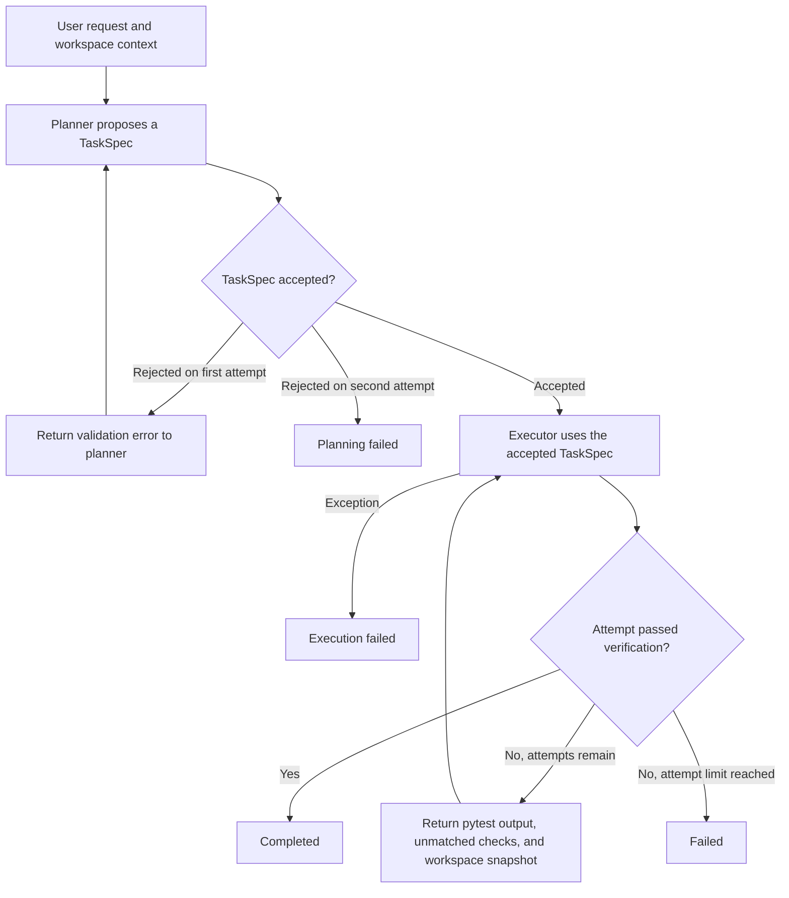

# Architecture

Dual-LLM Router separates **planning** from **execution**, then optionally co-evolves both prompts from scored run history.

## Runtime pipeline

`EvolvingRouter` loads the prompt variants for each run and records the result for co-evolution. The default pair was chosen for structured JSON planning with Hermes 4 and iterative, multi-file coding with Laguna S 2.1. Each role has its own model setting. See [Project proposal](Project_Proposal.md) and [Configuration](configuration.md).

```text
                         ┌──────────────────────────────────────┐
                         │         EvolvingRouter               │
                         │  (active hermes_* / laguna_* genomes)│
                         └──────────────────┬───────────────────┘
                                            │
                                            v
User / Trigger ──► [Planner: Hermes 4] ──► TaskSpec JSON
                   prompts/hermes/*            │
                   goal, target_files,         │
                   acceptance_criteria,        │
                   step_by_step_plan           v
                                   [Executor: Laguna S 2.1]
                                   prompts/laguna/*
                                   apply_patch / run_shell
                                            │
                                            v
                              Verification + metrics
                              (pass rate, cost, latency)
                                            │
                                            v
                                   Run result logged
                             .autoclaw/evals/run_results.json
```


### Layers and their responsibilities

| Layer | Entry point | Why it exists |
| --- | --- | --- |
| Router | [`router/`](../router/) | `DualLLMRouter` exposes the request pipeline. `EvolvingRouter` selects prompt variants and records outcomes, while `CoEvolver` connects the pipeline to evolution workflows. |
| Orchestration | [`src/orchestrator.py`](../src/orchestrator.py) | Owns the sequence from planning through execution and verification. It controls retries and carries the accepted spec through each executor attempt. |
| Planner | [`src/agents/planner.py`](../src/agents/planner.py) | Turns user intent and workspace context into a goal, target files, acceptance criteria, and a plan. The planner has no workspace tools. |
| TaskSpec | [`src/schemas/task_spec.py`](../src/schemas/task_spec.py) | Defines the shared handoff between planner and executor. Pydantic validates the JSON shape and structured check rules before execution. Both roles can change models while keeping the same handoff. |
| Executor | [`src/agents/executor.py`](../src/agents/executor.py) | Converts the accepted spec and available file context into workspace actions. It also consumes verification feedback when the orchestrator retries. |
| Model access | [`src/agents/provider.py`](../src/agents/provider.py) | The agents use LiteLLM for model calls. The provider helpers handle credentials, response settings, and retries so provider-specific behavior stays out of the handoff. |
| Prompts | [`prompts/`](../prompts/) | Keeps role instructions and few-shot examples separate from orchestration code. Prompt variants can be evaluated without changing the schema or tools. |
| Workspace tools | [`src/tools/`](../src/tools/) | Validates and dispatches a limited set of file and command actions. Each tool checks its arguments before acting on the workspace. |
| Verification | [`src/verification/`](../src/verification/) and [`src/agents/executor.py`](../src/agents/executor.py#L192) | Derives the verdict from observed workspace or test evidence. Structured checks match expected numeric values to assertions in passing tests. |
| Metrics and runtime state | [`src/utils/metrics.py`](../src/utils/metrics.py) and gitignored `.autoclaw/` | Records model calls, token counts, latency, and cost estimates. The evolving router persists run outcomes so scoring can use history across requests. |
| Evaluation and evolution | [`evals/`](../evals/) and [`benchmark/`](../benchmark/) | Compares variants on repeatable tasks across difficulty levels and domains. Scoring, A/B tests, and lineage track which prompt changes improve measured outcomes. |
| CLI and reporting | [`scripts/`](../scripts/) | Provides entry points for running benchmarks, evolving prompts, analyzing results, and publishing reports. |

### Tool selection and dispatch

The executor model proposes an ordered JSON `actions` list. When `execute_tools=True`, the router validates the entire list against the action schemas before dispatching by action type. An invalid action prevents the list from running. See [Action schemas](../src/tools/action_schemas.py) and [Executor dispatch](../src/agents/executor.py#L146).

| Tool | When it is selected | Why it exists |
| --- | --- | --- |
| [`apply_patch`](../src/tools/patch_tool.py) (`patch` alias) | The executor needs to create or update a file. | Writes the supplied contents to a workspace-relative path. The dedicated file tool keeps edits explicit and checks path components without following symlinks. |
| [`run_shell`](../src/tools/shell_tool.py) (`shell` alias) | The executor needs a supported workspace operation such as listing files or creating a directory. | Runs commands from a small allowlist without shell interpretation. It checks workspace path arguments and enforces a timeout. |
| [`pytest` runner](../src/verification/runner.py) | The verifier sees structured `TaskSpec.checks`. In automatic mode it chooses Docker when the image can import pytest and otherwise uses a restricted subprocess. `SHOWCASE_SANDBOX` can explicitly select either. | The verifier runs the tests itself and uses test results to identify passing assertions. The executor proposes the test files through `apply_patch`. |

## Feedback within a run



- **Planner correction.** If the first response cannot be parsed or validated, or its report checks fail validation against `issue.md`, the router adds the error to the planner prompt and asks for a corrected `TaskSpec`. A second rejection ends the run with `planning_failed`. See [Planner validation](../src/orchestrator.py#L113).
- **Executor retry.** After a failed attempt, the router passes the accepted `TaskSpec` back to the executor with available pytest output, checks whose expected values were missing from passing assertions, and a bounded snapshot of the current workspace. The executor works from the files left by the previous attempt. `max_iterations` counts total executor attempts and defaults to one. The issue-to-fix showcase allows three. An exception from the executor ends the run with `execution_failed`. See [Orchestrator](../src/orchestrator.py#L39), [Feedback builder](../src/verification/feedback.py#L52), and [Showcase](../src/showcase/session.py#L82).

## Co-evolution loop

Run results provide feedback across tasks. The evolution engine uses that history to score variants and evaluate challengers. `EvolvingRouter` loads the selected prompt variants for later runs.

```text
 run_results.json
        │
        v
 ┌──────────────┐     every N runs      ┌──────────────┐
 │   Scoring    │ ───────────────────► │   Mutation   │
 │ success/cost │                       │ hermes+laguna│
 │ quality/time │                       │  operators   │
 └──────┬───────┘                       └──────┬───────┘
        │                                      │
        │                                      v
        │                               challenger genomes
        │                               prompts/*/evolved/
        │                                      │
        v                                      v
 ┌──────────────┐     promote winner    ┌──────────────┐
 │  A/B Test    │ ───────────────────► │   Selection  │
 │  + lineage   │                       │ best_configs │
 └──────────────┘                       └──────┬───────┘
                                               │
                                               v
                                    alerts.jsonl / webhook
                                    (significant fitness gain)
```


The run interval is set in [`config/evolution.yaml`](../config/evolution.yaml).

1. **Score** active Hermes/Laguna variants from `run_results.json`
2. **Mutate** challenger genomes
3. **A/B test** when sample sizes allow
4. **Promote** winners into the active genomes under `.autoclaw/agents/genomes/`
5. **Persist** a reviewed copy under `evolution/promoted/` only after the gates in [ADR 0001](adr/0001-careful-genome-promotion.md)

Nightly CI evolves in simulation, writes `evolution/dashboard/`, and uploads `.autoclaw/` as an artifact. It commits the dashboard when the fitness fingerprint changes. It commits genomes only when a manual run sets `promote=true` and the gates pass.

## Evaluation surface

- Task runner: `evals/benchmark_runner.py`
- Comparative A/B: `evals/comparative_benchmark.py`
- Dashboard / system metrics: `evals/benchmark_dashboard.py`
- Fitness trend: `evolution/dashboard/` via `scripts/fitness_dashboard.py`
- Promoted genomes: `evolution/promoted/` via `scripts/promote_genomes.py`
- Published Markdown: `benchmark/published/benchmark_results_<timestamp>.md`

## Ecosystem role

Per the Labbys product portfolio, Dual-LLM Router is the **plan-and-execute** layer: a reusable engine behind applications or agent-synthetix, optionally fed by a model gateway (e.g. Camper Vane) and observed by Agent Lens.

See also: [`Project_Proposal.md`](Project_Proposal.md), [`Evolution.md`](Evolution.md), [`adr/0001-careful-genome-promotion.md`](adr/0001-careful-genome-promotion.md), [`../portfolio.yaml`](../portfolio.yaml).
